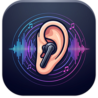

# VoiceNotify

Aplicación Android de código abierto que anuncia por voz los mensajes de **WhatsApp, TikTok, Messenger e Instagram**, solo en audífonos autorizados. Pensada para escuchar avisos cuando llevas el celular guardado o estás caminando.

**Versión: 0.1.4 · Android 10 o superior · Interfaz en español · Licencia MIT**

[Descargar el APK](https://github.com/JesusEchavandi/VoiceNotify/releases/latest) · [Instalación](docs/INSTALACION.md) · [Pruebas](docs/VALIDACION.md) · [Privacidad](docs/PRIVACIDAD.md)



## Funciones

- Anuncia solo la aplicación, aplicación y remitente, o también el mensaje; configurable por aplicación.
- Permite excluir conversaciones y personas y omitir grupos identificables.
- Funciona en modo **Sonido y Vibración**, con pantalla bloqueada o en segundo plano, siempre que Android permita el servicio.
- Usa una voz local en español instalada en el celular. Sin cuentas, servidor, publicidad ni analítica.
- Requiere audífonos autorizados; comprueba la ruta efectiva y detiene la reproducción ante desconexiones o rutas no seguras.
- Incluye pausa, detención, prueba de voz, velocidad, volumen y diagnóstico técnico sin texto de mensajes.
- Evita repeticiones, reproduce una voz a la vez y limita la cola a cinco avisos pendientes con caducidad de treinta segundos.

La voz se mezcla con música y videos sin pedir que se pausen o bajen su volumen. **Silencio**, No molestar, una comunicación detectable o volumen multimedia en cero bloquean la voz.

## Instalar y usar

1. Descarga `VoiceNotify-0.1.4-personal-preview.apk` desde [Releases](https://github.com/JesusEchavandi/VoiceNotify/releases/latest) e instálalo. Es una distribución por APK, fuera de Google Play.
2. Abre **VoiceNotify → Inicio → Abrir permiso** y concede acceso a notificaciones. Android puede pedir permitir ajustes restringidos en la información de la aplicación.
3. Conecta tus audífonos Bluetooth o USB-C y autorízalos en Inicio. Autoriza solo dispositivos que reconoces como audífonos: un parlante Bluetooth puede tener el mismo tipo de salida.
4. Configura un motor de voz con datos locales de español y pulsa **Probar voz en mis audífonos**.
5. Activa **Lectura** y configura las aplicaciones y filtros. El modo inicial anuncia aplicación y remitente.

Si no habla, revisa Diagnóstico: permiso, servicio, audífonos, voz, modo de sonido y volumen multimedia. En Samsung, revisa la batería de la aplicación si el sistema la suspende. [Guía completa](docs/INSTALACION.md).

## Compilar

Requisitos: **JDK 17 o 21**, Android SDK Platform **36**, Build Tools **36**, y acceso a Google Maven/Maven Central para descargar dependencias. Gradle Wrapper está incluido.

Abre la carpeta en Android Studio o configura `ANDROID_HOME` / un `local.properties` privado con la ruta del SDK. En Linux y macOS:

```bash
chmod +x gradlew
./gradlew :app:testDebugUnitTest :app:lintDebug :app:assembleDebug
```

El APK de desarrollo queda en `app/build/outputs/apk/debug/app-debug.apk`.

En Windows con PowerShell:

```powershell
./scripts/Build.ps1
```

Para generar una firma propia y compilar Release:

```powershell
./scripts/New-PersonalSigning.ps1  # Una sola vez; no sobrescribe claves existentes.
./scripts/Build.ps1 -Release
./scripts/PackageSource.ps1
```

En otros sistemas crea un almacén de firma con `keytool`, copia `signing.properties.example` a `signing.properties`, completa sus cuatro valores localmente y ejecuta `./gradlew :app:assembleRelease`. Las claves y contraseñas no se distribuyen: cada persona puede firmar sus propias compilaciones.

Para ejecutar la suite instrumentada usa un emulador dedicado y `:app:connectedDebugAndroidTest`. Puede reinstalar la aplicación y modifica algunos ajustes de prueba; no la ejecutes en un teléfono personal con ajustes que quieras conservar.

La fuente del ícono es `icono.jpg`. Para regenerar los recursos en Windows: `./scripts/Generate-AppIcon.ps1`.

## Actualizaciones y compatibilidad

El nombre visible es **VoiceNotify**. El identificador Android `com.notifyvoice.app`, sus paquetes internos y el nombre del almacén de preferencias se conservan por compatibilidad con el prototipo anterior. Permiten actualizar con la misma firma conservando ajustes y el componente del servicio de notificaciones. Los forks que necesiten coexistir en un teléfono deben elegir otro `applicationId`.

Para actualizar una instalación conserva su firma. Una compilación con otra clave no puede instalarse encima de ella; normalmente exige desinstalar y perder los ajustes.

Se compila y apunta a API 36 y se ha probado funcionalmente en Android 17 / API 37. No equivale a validar todos los fabricantes, versiones o audífonos. [Resultados y pruebas pendientes](docs/VALIDACION.md).

Capturas de la versión publicada: [Inicio](docs/images/inicio.png) · [Ícono y nombre en Android](docs/images/icono-android.png).

## Privacidad y límites

Se procesa lo que aparece en las notificaciones, no el historial de los chats ni sus adjuntos. Un aviso de chat con contenido oculto puede producir una frase genérica; los ambiguos se omiten. El formato puede variar entre versiones e idiomas.

Sin permiso de Internet, micrófono, contactos o estado del teléfono. El permiso especial de notificaciones es amplio, pero el código filtra las aplicaciones admitidas. Las preferencias se guardan localmente y las exclusiones explícitas pueden contener nombres. La síntesis crea WAV temporales en la caché privada y los elimina al terminar/cancelar o al siguiente inicio. [Detalles de privacidad](docs/PRIVACIDAD.md).

La detección de llamadas usa el modo de audio y puede no cubrir todos los casos. Conversaciones con el mismo nombre pueden compartir un filtro. Android puede limitar perfiles de trabajo o redactar información sensible.

Los cambios de ruta se notifican de forma asíncrona: el software no ofrece una garantía de corte de audio por hardware. Prueba las desconexiones con tus propios audífonos antes de confiar en ellos para contenido sensible. No se recuperan avisos antiguos al reconectar.

## Estructura y licencia

- `app/src/main`: interfaz Compose, servicio, adaptadores, filtros, cola, voz y preferencias.
- `app/src/test` y `app/src/androidTest`: pruebas unitarias e instrumentadas.
- `scripts`: compilación, firma, recursos del ícono y paquete de fuentes.
- `docs`: instalación, privacidad y validación.

[Licencia MIT](LICENSE). Puedes usar, modificar y redistribuir el proyecto conforme a ella, conservando sus avisos. No incluye iOS, respuestas por voz, transcripción, IA ni publicación en Google Play.
